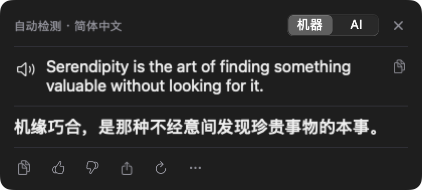
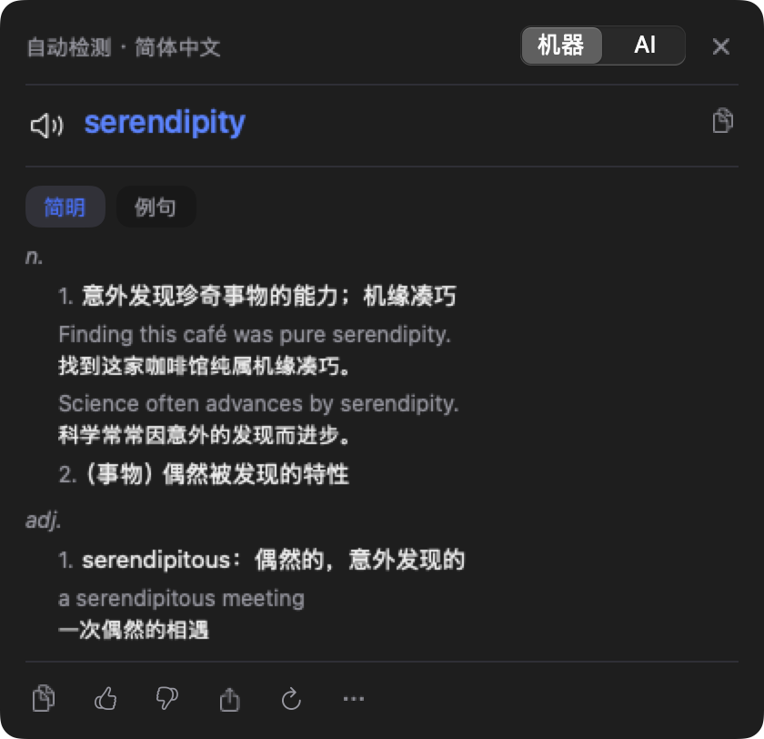
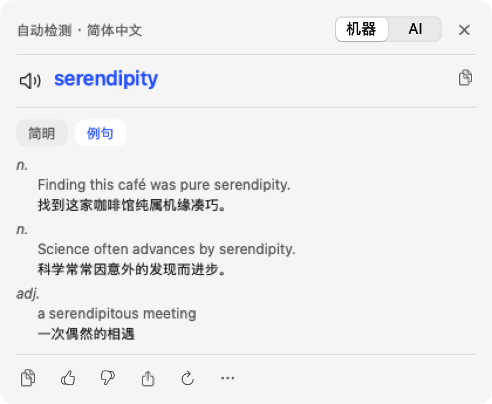
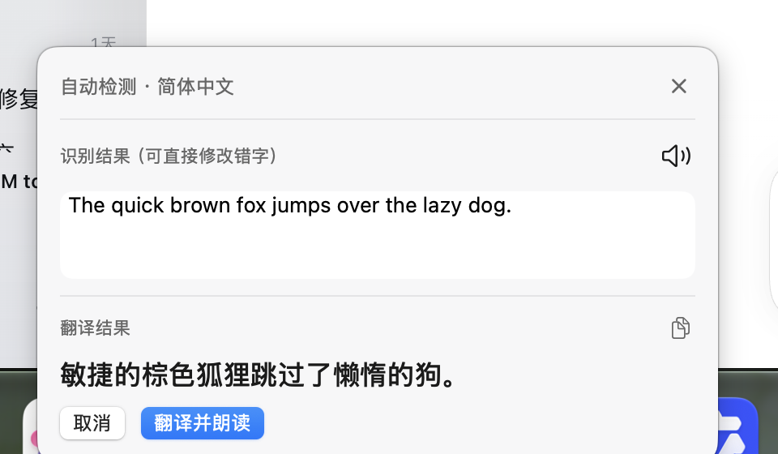
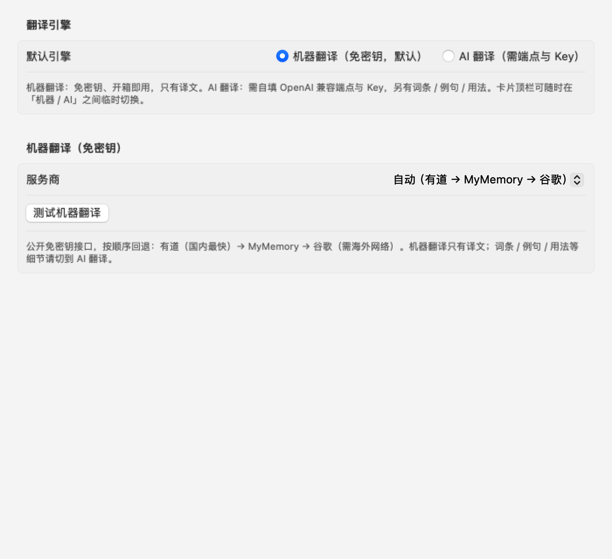
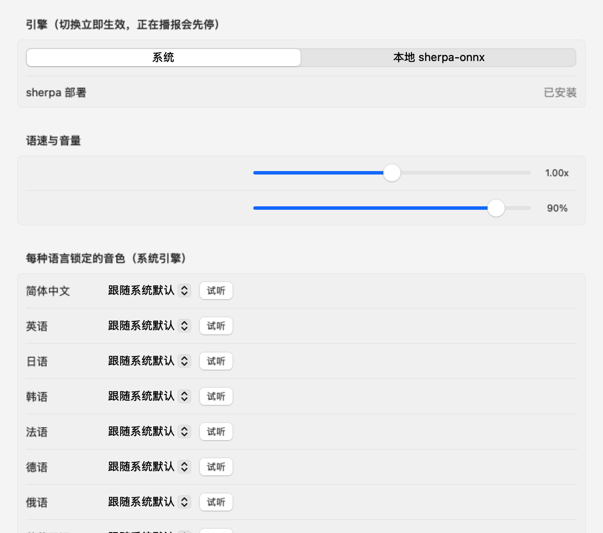
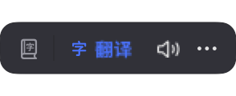
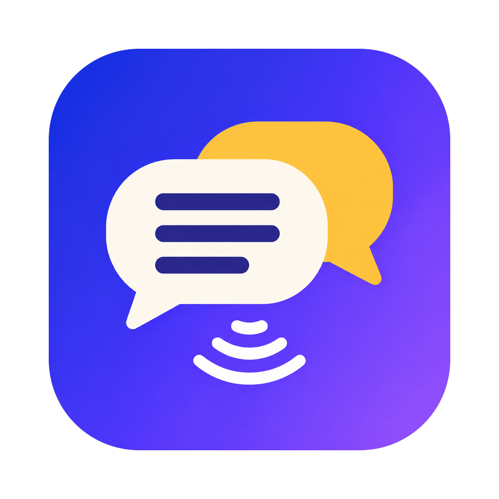

# TranslationReader · 全局翻译自动朗读

> 一个 macOS 菜单栏常驻的「划词 / 截图即翻译」工具。
> **默认机器翻译，装好就能用，不需要任何 API Key**；想要词条、例句、用法时再切到 AI 翻译。
> 朗读只读原文，译文永远不发声——不打断你的阅读节奏。

   



---

## 目录

- [为什么做这个](#为什么做这个)
- [功能](#功能)
- [截图](#截图)
- [安装](#安装)
- [使用](#使用)
- [翻译引擎](#翻译引擎)
- [朗读引擎](#朗读引擎)
- [隐私与安全](#隐私与安全)
- [架构](#架构)
- [构建与测试](#构建与测试)
- [已知限制](#已知限制)
- [参与贡献](#参与贡献)
- [开源协议](#开源协议)

---

## 为什么做这个

日常读英文资料时，最打断节奏的是「复制 → 切浏览器 → 粘贴 → 等页面」这一串动作；而常见的翻译工具又往往有两个问题：

1. **必须先配 API Key**，否则连一句都译不了；
2. **把译文也念出来**，双语的朗读反而干扰理解。

TranslationReader 的做法是：

- **零配置优先**：默认走机器翻译（有道 / MyMemory / 谷歌公开接口，免密钥），打开即用；
- **只读原文**：喇叭只出现在原文区，译文区永远没有播放按钮；
- **要细节再升级**：切到 AI 翻译后，才有词条、例句、用法、出处这些「词典式」内容；
- **两种取词方式**：任意 App 里划词，或者直接拖框截屏 OCR。

---

## 功能

| 入口 | 操作 | 说明 |
|---|---|---|
| 划词浮条 | 任意 App 选中文本 → 浮条出现在选区右上角 → 点「翻译」 | 需要「辅助功能」授权；AX 读不到选区时自动用 ⌘C 兜底 |
| 快捷键 `⌥Space` | 有选区译选区，否则译剪贴板 | 剪贴板这一半不需要辅助功能授权 |
| 快捷键 `⌥S` | 全屏变暗 → 拖框（`Esc` 取消 / `空格` 全屏）→ OCR → 确认 → 翻译 | 需要「屏幕录制」授权 |
| 快捷键 `⌥R` | 复读上一条原文 | 不重新翻译 |
| 菜单「手动输入…」 | 粘贴或输入一段文本 | 完全不需要任何系统权限的兜底路径 |
| 菜单「历史」 | 时间 / 原文 / 译文 / 来源 | 可朗读、复制、重译、只看收藏、导出 JSON |

**翻译与卡片**

- 默认**机器翻译**（免密钥）；可在卡片顶栏临时切「机器 / AI」，不写回设置。
- AI 翻译支持任意 OpenAI 兼容端点，两阶段：先流式出译文，再拿结构化词条（词性、义项、例句、近义、用法、出处）。
- 术语「标准 / 高级」= 两个模型名，切换立即重译。
- 译文缓存 30 分钟 / LRU 200，缓存键区分引擎，机器译文与 AI 译文互不覆盖。

**截图 OCR**

- 截图 → Vision 识别 → 卡片同屏给出「识别结果（可编辑）」+「翻译结果」两栏。
- 打开即自动翻译并朗读识别到的原文；识别错了改完点「翻译并朗读」按新文本重译。
- 识别有 12 秒硬超时（首次冷启动 45 秒），卡住会自动复位，不会把整条链路挂死。

**朗读**

- 默认系统语音 `AVSpeechSynthesizer`，零内存零延迟；可选本地 `sherpa-onnx`（中文 / 英文）提升音质。
- 9 种语言可分别锁定音色，语速、音量可调；本地引擎失败会自动回落到系统引擎。

---

## 截图

### 翻译卡片（默认机器翻译，免密钥）


### 词条卡（切到 AI 翻译才有）

| 深色 | 浅色 |
|---|---|
|  |  |

### 截图 OCR：识别结果 + 翻译结果两栏



### 设置

| 翻译引擎（机器翻译默认） | 朗读（系统 / 本地 sherpa） |
|---|---|
|  |  |

### 划词浮条



### 应用图标



---

## 安装

### 环境要求

- Apple Silicon（M 系列）Mac
- macOS 14 或更新
- 构建需要 Swift 6 工具链（Xcode 或 Command Line Tools）

### 从源码构建

```bash
git clone https://github.com/lanscer/TranslationReader.git
cd TranslationReader

make test          # 跑测试（首次会编译，较慢）
make app           # 组装 ~/Applications/TranslationReader.app 并签名
open ~/Applications/TranslationReader.app
```

`make app` 默认会找名为 `TranslationReader Dev` 的自签名证书；没有就用 ad-hoc 签名。
**ad-hoc 签名每次重建都会变，系统会把你当成另一个 App，辅助功能 / 屏幕录制需要重新授权。**
想要「重建后授权不失效」，先执行一次：

```bash
./scripts/make-signing-cert.sh
```

### 首次启动授权

菜单栏出现图标后，打开「设置 → 关于 → 权限自检」，按提示授予：

- **辅助功能**：划词浮条需要
- **屏幕录制**：截图 OCR 需要

授权后无需重启；若勾选了仍不生效，检查是否存在同名的旧条目（尤其是以前用 ad-hoc 签名构建过的情况），删除旧条目后重新授权。

> 仓库**不提供预编译二进制**，请从源码构建。自签名应用未经过 Apple 公证，自己构建并运行不需要绕过 Gatekeeper。

---

## 使用

### 快捷键

| 快捷键 | 功能 |
|---|---|
| `⌥Space` | 翻译选区（没有选区则翻译剪贴板） |
| `⌥S` | 截图 OCR 翻译 |
| `⌥R` | 复读上一条原文 |
| `⌘,` | 打开设置 |
| `Esc` / `⌘W` | 关闭当前卡片 |

### 卡片里的操作

- **原文区左侧喇叭**：朗读 / 复读；播放中再点立即停止。
- **译文区永远没有喇叭**。
- 顶栏：语言方向、机器 / AI 切换、（AI 时）标准 / 高级、关闭。
- 底部图标条：复制、赞、踩、分享、重新生成、更多（收藏）。
- 单词模式两个 tab「简明 / 例句」；句子模式「用法 / 出处」。没有内容时 tab 区整体隐藏。

### 设置页

翻译引擎 · 通用 · 快捷键 · 朗读 · 划词 · 历史 · 关于。

---

## 翻译引擎

### 机器翻译（默认，免密钥）

| 服务 | 端点 | 说明 |
|---|---|---|
| 有道 | `aidemo.youdao.com/trans` | 国内直连，通常最快 |
| MyMemory | `api.mymemory.translated.net` | 免费额度，全球可用 |
| 谷歌 | `translate.googleapis.com` | 需要海外网络；放最后兜底 |

- 默认「自动」：按 **有道 → MyMemory → 谷歌** 顺序回退，任一家失败立刻换下一家，全挂才报错并提示可切 AI。
- 按 UTF-8 字节分块（3000 / 450 / 1800），优先句末标点断开，结果按换行拼回。
- 局限：**只有译文**，没有词条、例句、用法。

### AI 翻译（可选）

- 任意 OpenAI 兼容 `/chat/completions` 端点（官方、中转、自建都行）。
- Stage 1：`stream=true` 拿纯译文增量，首屏更快。
- Stage 2：`stream=false` 要求严格 JSON，返回词性、义项、例句、近义、用法、出处；失败只隐藏细节，不影响译文。
- 设置里可以「测试连接」并「拉取模型列表」，模型名支持厂商前缀（如 `deepseek/deepseek-v4.1-flash`）。

### 切换方式

- **设置 → 翻译引擎 → 默认引擎**：持久化默认值。
- **卡片顶栏「机器 / AI」**：只影响当前这张卡，方便临时查词条。

---

## 朗读引擎

| 引擎 | 内存增量 | 首字延迟 | 语言 | 启用条件 |
|---|---|---|---|---|
| 系统（`AVSpeechSynthesizer`） | ≈0 | ≤80ms | 系统全部音色 | 默认 |
| 本地 sherpa-onnx | 150–250MB | 冷启约 1s | 中文（华研 / Matcha）、英文（Amy） | 手动安装模型后可选 |

```bash
./scripts/install-sherpa.sh   # 下载运行时与中文/英文模型到 Application Support
```

- 切换引擎立即生效，正在播放会先停止；本地引擎失败会 toast 一次并回落系统引擎。
- 只朗读原文；译文永远不发声。

---

## 隐私与安全

- **仓库不含任何密钥**，也不包含任何本机配置或历史数据。
- `apiKey` 默认存本地文件：

  ```text
  ~/Library/Application Support/TranslationReader/apikey.bin
  ```

  权限 `0600`、父目录 `0700`、临时文件 + rename 原子替换，内容只做轻量混淆（**防肩窥，不防本地取证**）。也可以切换为钥匙串存储。
- 内存里每会话最多读一次密钥；网络请求路径绝不触发钥匙串弹窗；错误信息与日志会脱敏。
- 日志写 `~/Library/Logs/TranslationReader/app.log`（2MB 轮转），不包含密钥。
- **无遥测、无统计上报。**

**数据去向**：机器翻译会把待译文本发送给对应公共服务；AI 翻译发送给你自己配置的端点。如果内容敏感，请使用自建端点或不要在敏感场景使用。

---

## 架构

| 模块 | 职责 |
|---|---|
| `AppShell` | 应用装配、菜单栏、卡片、设置、历史、权限、日志 |
| `Contracts` | 冻结的共享契约（设置、翻译、朗读、历史、错误） |
| `DesignSystem` | 颜色 / 字体 / 词条块 / 图标条 / 卡片壳 |
| `TranslateKit` | 机器翻译 Provider + OpenAI 兼容两阶段 Provider、SSE、缓存 |
| `SpeechKit` | 朗读引擎协议、系统与 sherpa 实现、分句预取、缓存 |
| `OCRVision` | Vision 文字识别、版面后处理、语种判断、预热与超时 |
| `CaptureKitX` | ScreenCaptureKit 区域截图、全屏选择器 |
| `SelectionKit` | AX 选区读取、⌘C 兜底、隐私闸门 |
| `OverlayKit` | 浮条与卡片窗口、落位计算 |
| `HotkeyKit` | Carbon 全局热键、录制器、冲突检测 |
| `Store` | SQLite 历史库、设置持久化、密钥存储 |

依赖方向单向：`AppShell` → 各业务库 → `Contracts`；业务库之间不互相 import，装配集中在 `AppEnvironment`。

```text
Sources/
├── AppShell/        # 可执行目标（菜单栏、卡片、设置、历史…）
├── Contracts/       # 共享类型与协议
├── DesignSystem/    # 设计 token 与组件
├── TranslateKit/    # 机器翻译 + AI 翻译
├── SpeechKit/       # 系统 / sherpa 朗读
├── OCRVision/       # Vision OCR
├── CaptureKitX/     # 截图与区域选择
├── SelectionKit/    # 划词读取与兜底
├── OverlayKit/      # 浮条 / 卡片窗口
├── HotkeyKit/       # 全局热键
└── Store/           # SQLite / 设置 / 密钥
Tests/               # swift-testing（181 个测试 / 29 个 suite）
docs/                # 开发文档、验收报告、朗读引擎部署、截图
scripts/             # 组装 .app、签名证书、安装 sherpa 模型
```

更多设计细节见 [开发文档](docs/开发文档.md)、[验收报告](docs/验收报告.md)、[朗读引擎部署](docs/朗读引擎部署.md)。

---

## 构建与测试

```bash
make build    # swift build -c release --arch arm64
make app      # 组装 ~/Applications/TranslationReader.app 并签名
make test     # 构建测试包 + 跑测试（181 tests / 29 suites）
make clean
```

> 本机若只有 Command Line Tools（没有 Xcode），SwiftUI 宏（`@State` / `@Observable` / `#Preview`）不可用，所以项目统一使用 `@StateObject` / `@ObservedObject` + `ObservableObject`。有 Xcode 的环境同样能编译。

### 诊断命令

```bash
# 自检：RSS、冷启动、OCR、朗读、翻译首字等
.build/debug/TranslationReader --selftest

# 离线渲染卡片/设置页截图（不依赖屏幕录制权限）
.build/debug/TranslationReader --render-evidence

# 机器翻译在线冒烟（免密钥）
.build/debug/TranslationReader --mt-smoke

# 截图 → Vision OCR 冒烟（打印预热与识别耗时）
.build/debug/TranslationReader --ocr-smoke

# 卡片全链路冒烟（phase / 耗时 / 译文）
.build/debug/TranslationReader --card-smoke
```

---

## 已知限制

- 仅支持 Apple Silicon（`arm64`），最低 macOS 14。
- 应用未做 Apple 公证；自行构建运行没问题，但拷给别人时首次打开需要处理 Gatekeeper（右键打开 / 系统设置允许）。
- OCR 首次调用需要加载 Vision 模型，冷启动约 30 秒；之后单次 0.4–1 秒。
- 谷歌翻译在国内网络通常不可达，自动链会跳过它。
- 机器翻译依赖公开接口，没有 SLA；接口变化时可能需要更新。
- 本地 sherpa 朗读模型不随仓库分发，需要脚本下载。
- 每次重新签名（尤其 ad-hoc）都会导致辅助功能 / 屏幕录制需要重新授权；用稳定证书可以避免。

---

## 参与贡献

- 欢迎 Issue / PR。提交前请跑 `make test`。
- **请不要提交任何密钥、本机配置、日志或历史数据库**。`.gitignore` 已排除 `apikey.bin`、`.build*`、`dist/`、签名材料等。
- 涉及界面改动时，建议附一张 `--render-evidence` 渲染图或实机截图。

---

## 开源协议

[MIT](LICENSE)
